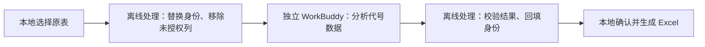

# 隐私保护 Skill

**让 AI 处理表格，让身份信息留在本地。**

适用于需要处理名单、统计数据和导入表的教师与行政人员。原表在本地转换为代号数据，AI 完成分析后，再由本地程序回填身份，生成 Excel 文件。

[下载安装包](https://github.com/Jiaqi-Guo-0114/privacy-assistant/releases/tag/v0.6.1) · [支持范围](docs/compatibility.md)

> 当前为预发布版本。Windows x64 完整流程尚未实机验收，请先用虚构表格试用。

## 开始使用

下载 Release 中的 **`privacy-assistant-0.6.1-windows-x64.zip`**，交给能在本机执行操作的 Agent，发送：

> 请安装并打开这个隐私保护 Skill。只读取安装包，原表由本地窗口选择。

安装器负责下载所需组件、建立独立环境并执行自检。首次系统授权和 WorkBuddy 登录由本人完成。解压后也可双击 **启动隐私助手.cmd**。

安装后，在自动打开的独立 WorkBuddy 窗口中完成三步：

| 步骤 | 操作 |
| --- | --- |
| 说任务 | 说明需要统计、筛选哪些记录，以及希望得到什么结果。 |
| 选文件 | 在本地窗口选择原表，指定本次允许提供给 AI 的列。 |
| 确认结果 | 核对本地回填的姓名、编号与结果，确认生成导入文件。 |

例如：

> 筛选分数达到 40 的记录，新增“是否跟进”和 0—3 的“优先级”，生成导入表。不要改动原有数值。

运行环境和账号资料保存在本机，关闭窗口后不会重新安装。服务商要求重新认证时，仍需本人登录。

## 支持哪些任务

- XLSX 第一张工作表或 UTF-8 CSV。
- 数值统计、分类汇总和记录筛选。
- 新增“是否跟进”和 0—3 的“优先级”。
- 按原始身份编号回填，生成全部记录或选定记录的 Excel。

任意新增列、自由文本、公式和自动提交业务系统暂不支持。结果文件由本人核对后导入。

## 数据如何流动

原表、身份映射和实名导出文件不进入独立 WorkBuddy。两个运行环境关闭共享文件夹、主客机剪贴板和拖放，通过受限接口传递允许的数据。

**代号化仍可能保留可关联的信息。** 只选择任务必需的列，并遵循所在单位的数据使用要求。原表不要拖入聊天；主机上原来的 Agent 窗口不会因安装本 Skill 自动受到隔离。

## 使用条件

- Windows x64，Windows 10 2004 或更新版本。
- 至少 8 GB 内存、12 GB 可用磁盘空间，已开启硬件虚拟化。
- 首次安装需要联网下载组件，并允许系统安装授权。
- 支持由本地 WorkBuddy、Codex 或 Claude Code 发起安装；Windows 的受保护工作环境统一使用 WorkBuddy。纯云端 Agent 不能直接部署到用户电脑。

保护检查或首次虚构表格自检失败时，程序停止接收原表。具体测试结果与 macOS 支持范围见[兼容性说明](docs/compatibility.md)。

## 许可证与反馈

项目代码采用 [MIT License](LICENSE)。第三方组件保留各自许可证，见[第三方说明](THIRD_PARTY_NOTICES.md)。

[报告问题](https://github.com/Jiaqi-Guo-0114/privacy-assistant/issues)时，请使用虚构样例，不要附学生资料、账号凭据或身份映射。源码构建方法见[开发说明](docs/development.md)。
