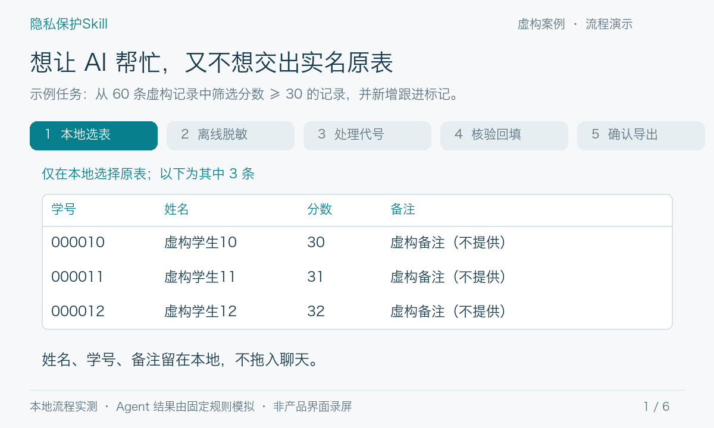

# 隐私保护Skill

**你在使用 AI 时，有没有这些烦恼？**

- 表格里有姓名、学号和联系方式，想提高效率，又不想直接上传。
- 删掉身份以后能分析，却很难把结果对应回原来的人。
- 一份工作纪要需要整理待办，但不适合交给云端模型。
- 工具装好了，还要选字段、换窗口、反复确认，操作比手工处理还复杂。

**说任务，选文件，在本地拿到结果。**

0.9.0 将数据处理放到后台：表格由本地程序筛选、排序、统计并回填；文档由断网运行的本地模型选取原文段落，生成摘要或待办。原件、代号稿和实名结果正文都不提供给云端模型，不需要第二个在线会话。

> 当前是本地验收版。GitHub 已发布的 [v0.7.0](https://github.com/Jiaqi-Guo-0114/privacy-assistant/releases/tag/v0.7.0) 仍是旧流程，不包含下述后台文档功能；本轮尚未更新线上发布包。

## 能完成什么

| 功能 | 支持的工作 | 生成文件 |
| --- | --- | --- |
| 表格保护 | 明确数值条件筛选、数值升降序、记录数和数量合计/均值，新增统一跟进标记与0—3优先级 | Excel，保留原值和身份 |
| 文档保护 | 本地识别人名等片段，选取重要原文段落，生成提取式摘要或未完成待办摘录 | Word、TXT |

XLSX 读取第一张工作表，也支持 UTF-8 CSV。文档支持 TXT/MD、基础 DOCX、纯文字 PDF。文档摘要保留原文表述，不是任意改写；选段仍可能遗漏，应阅读最终结果。排序仅支持数值列。分组、复杂公式、任意新增列和自动提交业务系统不在当前范围；不能识别的条件会停止处理，不静默省略。

## 怎么使用

把完整 ZIP 交给能执行本地操作的 Agent：

> 请安装这个隐私保护Skill。以后涉及隐私文件时，用它在后台处理，不把原件上传聊天。

然后直接说任务，例如：

> 筛选待补材料数不低于3的记录，按待补材料数从大到小排列，新增是否跟进为需跟进、优先级统一为1。

> 把这份工作纪要整理为未完成待办，保留负责人、交给谁、数量和期限，排除已结束事项和纯分工说明。

没有提供路径时，只出现一次本地文件选择器；已有路径就直接处理。无需选择功能、填写敏感词、逐列配置、切换聊天窗口或点击启动/导出同意。完成后 Agent 给出本地结果链接。原件不要直接拖进聊天。

首次自动下载约 **1.1 GB** 的本地模型，之后复用，不要求重新登录当前 Agent。推理程序随完整 ZIP 提供，模型从国内 ModelScope 的官方 Qwen 仓库下载，并核对固定 SHA-256。

## 实际验收结果

在 Apple Silicon Mac 上，独立测试者使用另一组虚构材料，通过真实后台入口完成了四项请求：

| 请求 | 实际结果 |
| --- | --- |
| 8条记录中筛选待补材料数≥3，并新增跟进/优先级 | 正确选出5条，身份、原值、新增列和统计逐项一致 |
| 从6段工作纪要提取未完成待办 | 仅保留第2、3、6段，排除已结束事项和纯分工；对象、责任关系与期限保留 |
| 筛选后按数量降序排列 | 6、5、4、3、3 |
| 没有符合条件的记录 | 正常生成只有表头的结果，统计为0 |

文档实际调用了 **2次本地模型**；表格由确定性程序完成，没有模拟模型结果或填写中间答案。四项均无中途确认，原文件未改变。早期验收发现过错误，修复后重新跑通；完整范围见[验收记录](docs/acceptance-0.9.0.md)。这些样例通过不代表所有文档都能正确选段。

### 早期流程示意

此动画展示旧版机制，**不是0.9.0界面录屏**。其中 Agent 结果是固定规则模拟；不能用它代替上面的后台实测。

## 原理

表格列名和业务数值始终留在本地，因此不用把“待补材料数”变成含义不明的代号列。身份以记录代号衔接，再回填到输出。

文档先在本地识别人名等片段，再由本地模型选择原文段落，程序按原文生成结果，避免模型改写人物关系。**即使身份识别漏掉了某个人名，正文也不会因此被发给云端**。这不等于自动识别百分之百准确，也不把代号稿称为不可重识别的匿名材料。

Mac 的数据处理进程禁止网络、Apple Events 和 Mach 服务访问，子进程继承限制。Windows 通过没有网卡的离线虚拟机处理材料。联网只用于处理开始前下载固定组件；不需要在第二个 WorkBuddy 或 Codex 窗口里处理数据。

Skill 保护自己的处理流程，不能撤销宿主 Agent 原本获得的文件权限，也不能阻止其他软件、截图或主动上传。安装 Skill 不等于整台电脑被隔离。

## 设备与边界

- **Apple Silicon Mac**：已完成本地后台真实推理与导出验收，需要 Python 3.9+。
- **Intel Mac**：提供对应运行组件，尚未实机验收。
- **Windows x64**：已适配离线虚拟机后台入口；需要 Windows 10 2004+、8 GB内存、12 GB可用空间及硬件虚拟化。仍待 Windows / WorkBuddy 整机验收，首次安装可能需要系统管理员授权或重启。

上述客户端需要本地执行能力；纯网页/云端 Agent 无法替用户电脑安装本地保护组件。系统权限和单位设备策略不能由 Skill 绕过。

文档正文限2万字符、单段不超过2400字；不处理扫描件、加密文件、标密材料、宏、活动内容和带修订/批注等复杂内容。具体范围见[文档说明](docs/documents.md)和[兼容性说明](docs/compatibility.md)。

## 许可证与反馈

代码采用 [Apache 2.0](LICENSE)，原创文档、Skill 指令与流程图采用 [CC BY 4.0](LICENSE-CC-BY-4.0)。第三方程序和模型保留各自许可，见[第三方组件](THIRD_PARTY_NOTICES.md)。

[报告问题](https://github.com/Jiaqi-Guo-0114/privacy-assistant/issues)时使用虚构样例，不附学生资料、凭据或身份映射。源码构建见[开发说明](docs/development.md)。
